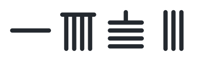
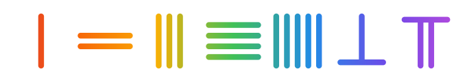
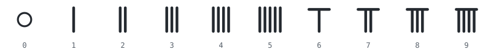

# counting-rods

Render any number as [Chinese counting rod numerals](https://en.wikipedia.org/wiki/Counting_rods): SVG with zero dependencies, plus PNG, JPEG and WebP through [sharp](https://sharp.pixelplumbing.com/).

**[Docs and playground](https://karlnorling.github.io/counting-rods/)** · [Storybook](https://karlnorling.github.io/counting-rods/storybook/)

| Package                                                   | What it does                                     |
| --------------------------------------------------------- | ------------------------------------------------ |
| [`@counting-rods/core`](packages/@counting-rods/core)     | Numbers to SVG. No dependencies, runs anywhere.  |
| [`@counting-rods/raster`](packages/@counting-rods/raster) | Numbers to PNG, JPEG or WebP in Node, via sharp. |
| [`@counting-rods/cli`](packages/@counting-rods/cli)       | The `counting-rods` command.                     |

<p>
  
  
  
  
</p>
<p>
  
  
</p>

For around two thousand years, Chinese mathematicians calculated by laying out bamboo rods on a counting board. One to five are that many rods, and six to nine put a crossing rod worth five above the rest. Places alternate between upright rods (units, hundreds) and flat rods (tens, thousands), so neighbouring digits never run together.



## Usage

```sh
npm install @counting-rods/core
```

```js
import { toSvg } from '@counting-rods/core';

const svg = toSvg(1993);
const red = toSvg(1993, { size: 200, color: '#c00', background: 'white' });
```

```sh
npm install @counting-rods/raster
```

```js
import { toImage } from '@counting-rods/raster';
import { writeFile } from 'node:fs/promises';

await writeFile('1993.webp', await toImage(1993, { format: 'webp', size: 400 }));
```

### Command line

```sh
npx @counting-rods/cli 1993 > 1993.svg
npx @counting-rods/cli 3.14159 -o pi.webp --size 200
npx @counting-rods/cli -42 -o minus.png --traditional-colors
```

Installed globally (`npm install -g @counting-rods/cli`), the command is `counting-rods`. Run `counting-rods --help` for every option.

### Colours and gradients

`color` and `background` take any CSS colour, or a CSS gradient: `linear-gradient()`, `radial-gradient()` and their `repeating-` forms. A gradient spans the whole image.

```js
// Rainbow
toSvg('1234567', {
  color: 'linear-gradient(to right, #e03131, #f76707, #fab005, #40c057, #228be6, #7048e8, #be4bdb)',
});

// Christmas
toSvg('2026.1225', {
  color: 'repeating-linear-gradient(135deg, #e03131 0 3%, #ffffff 3% 6%)',
  background: 'radial-gradient(#2b8a3e, #0b3d20)',
});
```

## Numbers the rod calculators didn't write

Rod numerals were decimal and positional, so whole numbers of any size need no extension. The historical options are here too:

| Input  | Drawn as                    | Rule                                                                                                    |
| ------ | --------------------------- | ------------------------------------------------------------------------------------------------------- |
| `305`  | 3, 〇, 5                    | Zero is a circle by default, the sign used from the 13th century. `zero: 'blank'` leaves a gap instead. |
| `11`   | a flat 1, then an upright 1 | Places alternate orientation, so 11 never looks like 2.                                                 |
| `3.14` | 3, a dot, 1, 4              | A dot on the baseline marks the decimal point. Fraction places keep alternating.                        |
| `-42`  | 42 with a diagonal rod      | A rod across the last digit, the sign Song-dynasty mathematicians used.                                 |
| `-42`  | black rods                  | With `traditionalColors`, positive numbers are red and negative ones black, as on a counting board.     |

Counting boards wrote fractions with a unit marker rather than a point; the dot is a modern addition.

Inputs can be a `number`, a `bigint` or a decimal `string`. A number is first written in its shortest exact form, so `0.1` draws as `0.1`. Strings and bigints keep every digit.

## API

### `toSvg(value, options?)` → `string` from `@counting-rods/core`

| Option              | Default        | Notes                                                                                                                             |
| ------------------- | -------------- | --------------------------------------------------------------------------------------------------------------------------------- |
| `size`              | `100`          | Image height in pixels. The width follows from the number of places.                                                              |
| `color`             | `currentColor` | Colour of the rods. Takes a colour or a gradient.                                                                                 |
| `background`        | none           | Colour or gradient behind the numeral.                                                                                            |
| `gap`               | `18`           | Space between places, in viewBox units.                                                                                           |
| `padding`           | `20`           | Space around the numeral, in viewBox units.                                                                                       |
| `strokeWidth`       | `7`            | Rod thickness in viewBox units, where a rod is 60 long.                                                                           |
| `zero`              | `circle`       | `circle` draws zero as 〇. `blank` leaves the place empty, as the earliest rod numerals did.                                      |
| `traditionalColors` | `false`        | Red rods for positive numbers and black for negative, as on a counting board. Replaces `currentColor`, but not a colour you pass. |
| `title`             | the number     | Accessible name. `false` leaves it out and sets `aria-hidden`.                                                                    |

### `toImage(value, options?)` → `Promise<Buffer>` from `@counting-rods/raster`

Takes every `toSvg` option, plus `format` (`png`, `jpeg`, `jpg` or `webp`; default `png`) and `quality` (1–100). Colours default to black. JPEG gets a white background unless you pass one.

### Lower level, from `@counting-rods/core`

- `parse(value)` → `{ negative, integer, fraction }`: the base-10 digits that get drawn.
- `format(parsed)` → the canonical decimal string, e.g. `-12.5`.
- `digitSvg(digit, place?, options?)` → one digit on its own.
- `parseGradient(css)` → the object form of a CSS gradient string, or `undefined` for a plain colour.
- `orientation(place)` → `vertical` for even powers of ten, `horizontal` for odd ones.
- `digitRods(digit, orientation)` → the rods of one digit as line segments, for drawing somewhere else.

## Development

```sh
yarn install
yarn test        # all packages, straight from source
yarn build       # core, then raster, then cli
yarn docs        # docs site with the playground, on localhost:4322
yarn storybook   # Storybook on localhost:6006
yarn examples    # regenerate examples/
```

## License

MIT
